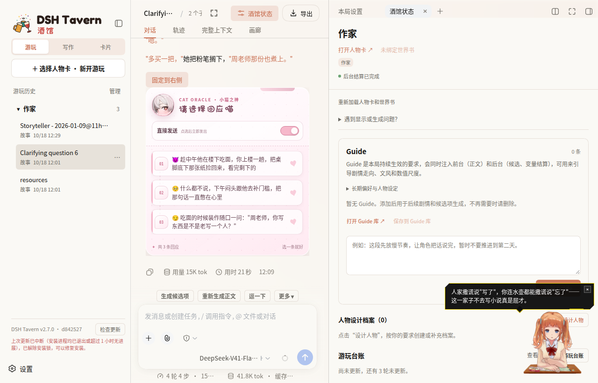
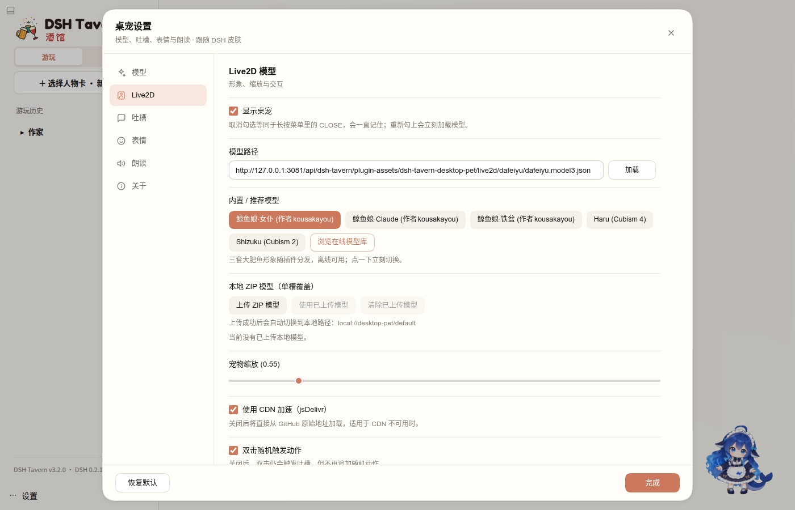

# dsh-tavern-desktop-pet

把 [tavern-desktop-pet](https://github.com/bigmalove/tavern-desktop-pet)（原名「酒馆桌面宠物」，SillyTavern 的 Live2D 桌宠扩展）搬到 DSH Tavern 里的插件。

桌宠是一层浮在页面右下角的 Live2D 模型：它跟着这一局的正文，按间隔吐槽、按情绪换表情、念台词（配音走 Tavern 已有的渠道），长按出功能菜单，双击立刻逗一次。

**这个仓库本身就是一个 DSH Tavern 插件。**根目录就是插件文件夹：`package.json` 是清单，`index.mjs` 是宿主侧，`client.js` 是浏览器侧。放进 Tavern 的 `plugins/` 目录即可加载，不需要先构建。



设置面板共六页（模型 / Live2D / 吐槽 / 表情 / 朗读 / 关于），点右下角桌宠长按、或侧栏「桌宠」页都能打开。面板、在线模型库、侧栏页、长按菜单和吐槽 / 状态气泡都使用 DSH 的设计令牌，会跟着浅色 / 深色与 Dream Skin 皮肤一起切换：



## 状态

| 能力 | 状态 |
|---|---|
| 浮层桌宠（Live2D，Cubism 2/4/5） | 已验证：模型从 CDN 加载并挂到 canvas，可拖动、可缩放、自动动作循环 |
| 侧栏「桌宠」面板（打开设置 / 逗一下 / 状态 / 挑吐槽模型） | 已验证 |
| 设置面板（6 页：模型 / Live2D / 吐槽 / 表情 / 朗读 / 关于） | 已验证：逐个点开都有内容，模型页下拉列出真实通道与模型（实测 65 项） |
| 输入框上方「逗一下」按钮 | 已验证 |
| 长按菜单（聊天 / 动作 / 换形象 / 吐槽人设 / 设置 / 关闭桌宠） | 已验证 |
| 吐槽链路（读正文 → 宿主 → 模型 → 气泡 → 情绪表情） | 已验证：故事局点「逗一下」拿到 50 字回复，情绪标签 `生气` 驱动了表情 |
| 没有卡的对局（写作 / 剧本） | 已验证：舞台接口拒绝后改按轮读正文 |
| 自动朗读（走 Tavern 配音渠道） | 已接：`tavernUi.speak` + 情绪映射；试听会如实报「没渠道 / 已播放」，本机配音关闭时返回 false |
| 上线/下线的清理（Vue 卸载、样式移除、全局垫片还原） | 已验证 |
| 关闭桌宠（长按菜单「关闭桌宠」 / 设置里的「显示桌宠」） | 已接：关闭状态写进脚本变量，刷新后不再自动挂出；侧栏「桌宠」页或设置里可重新打开 |
| 一轮写完自动吐槽 | 逻辑走单测 + 手动触发验证，未做「真实一轮」的端到端 |
| 卡片工作台引导（念提问、选项按钮、折叠主区提问） | 已接 Tavern 第 6 版接口（`watchReply` / `registerReplyPresenter`）；解析器与状态机走单测，真实工作台待手动验证 |
| 工作状态表情（思考 / 干活 / 等你回答 / 刚忙完 / 出错） | 已接 Tavern 第 7 版 `watchWorkStatus`；引导员或气泡在时不抢镜头，侧栏「桌宠」页显示当前状态 |
| 工作状态气泡（生成中 / 干活中 / 等你回答 / 写完了 / 出错了） | 头顶一行短句，跟着状态出现和收起；同一状态每 5 秒换一句；引导/吐槽气泡优先，不叠两层 |
| 占用锁：引导期间这一局的 `voice` 归桌宠 | 已接 Tavern 第 7 版 `acquireLease` / `getLease`；自动吐槽先查锁，别的插件占着就让路 |

## 卡片工作台引导

在卡片工作台（左侧「新建卡片工作台对话」）里，桌宠换一个角色：它念建卡 AI 的提问，A～E 选项变成气泡里的按钮，点一下就作为玩家输入发送；主区里那条提问折叠成一行 `🐾 第 N 题：… · 展开`。

桌宠会**停靠到输入框正上方**（与对话栏同宽）：左边是半身像，右边是气泡和选项，读题、点选项、打字都在同一条横带里，不再挡住正文。离开工作台或关掉引导，它会回到右下角原来的位置。

- 只在 Tavern 的 `tavernUi.apiVersion >= 6` 时启用；旧版本自动退回普通吐槽。
- 开关在侧栏「桌宠」页：`卡片工作台引导`（默认开）、`提问在主区折叠成一行`（默认开）。关掉立即生效，主区恢复原文。
- 生成中只显示、不解析；写完后解析一次再给按钮，避免选项闪来闪去。
- 点「你定 / 其他想法」类选项只把输入框清空并聚焦，不替你发送；发送后按钮立刻禁用。
- 卡片工作台的其他任务也适用：修改人物卡、温和改写、转 MVU、创建写作 Skill、从剧本新建、修改剧本/世界书/预设、空白开始。没有 A～E 的开放问题会给一个「回答」按钮（只聚焦输入框），改完其他产物时按回复里的路径识别收尾（「改好啦」）。
- 解析不了回复时（报告、清单、模型换了格式）主区原样显示，桌宠只说第一句。
- 刷新页面后如果最后一条仍是提问，桌宠会直接进入「等回答」状态。
- 念台词时桌宠会做说话口型（`ParamMouthOpenY` 一类参数），**和有没有配置 TTS 无关**：没配音也动嘴，有配音时口型按字数估算时长。
- 调试：控制台里 `window.__dshTavernPetDebug` 能读当前引导状态、是否在说话和口型开合值。

实测注意：模型对极端情节会直接拒绝（连吐槽也一起拒），这是模型自身的内容策略，换个模型或换段剧情即可。

## 工作状态与占用锁

接 Tavern 第 7 版接口，两件事都做了降级：

- **工作状态**（`tavernUi.watchWorkStatus`）：这一局在思考、跑工具、等你回答、刚写完、出错时，桌宠换对应表情；引导员在或气泡正显示时不动，避免抢镜头。侧栏「桌宠」页会显示「工作状态：思考中 / 干活中 · 工具名 / 等你回答 / 刚忙完 / 出错了」。旧版 Tavern 没有这个接口时，桌宠按原来的回合吐槽工作。
- **占用锁**（`tavernUi.acquireLease`，scope `voice`）：在卡片工作台引导期间，桌宠拿住这一局的 `voice`，别的插件用 `getLease` / `watchLease` 能看到并让路；离开工作台、关掉桌宠或换局就释放，TTL 2 分钟兜底。自动吐槽在开讲前先查这把锁，被别的插件占着就跳过这一轮。旧版 Tavern 没有锁时全部照旧。

两件事都不改变游戏内容，只影响桌宠自己的表情和是否开口。

## 内置形象

插件自带三套大肥鱼 Live2D 模型（Cubism 4，每套 23 组动作、15 个表情）：女仆装（默认）、
Claude 装、铁盆装，分别放在 `assets/live2d/dafeiyu/`、`assets/live2d/dafeiyu-claude/`、
`assets/live2d/dafeiyu-basin/`。三套都随插件分发、离线可用；打开设置 → Live2D →
「内置 / 推荐模型」点一下即可切换，刷新后保持选择。

首次加载默认用女仆装；之前用 CDN shizuku 的旧默认值会自动迁过来，自己挑过模型的不会被
改动。换端口 / 插件目录后，已选内置形象的旧地址会自动迁到新地址。

三套模型来自 [`jerryzmtz/dsh-tavern-galgame`](https://github.com/jerryzmtz/dsh-tavern-galgame)
的 `alpha-r12` 发行附件 `dafeiyu.zip`，角色与素材署名见
[`assets/live2d/dafeiyu/NOTICE.md`](assets/live2d/dafeiyu/NOTICE.md)（两个变体目录下也有
各自的 NOTICE）：大肥鱼（鲸鱼娘 DeepSeek 同人），原作 上善无形，女仆二次设计 ZipZipPipe，
衍生素材 kousakayou，按 CC BY-NC-SA 4.0 非商业分享。

## 安装

Tavern 的插件就是「一个文件夹放进数据目录的 `plugins/`」——加载器读 `package.json` 的 `exports["."]`（宿主侧）与 `dsh.client` + `exports["./client"]`（浏览器侧），然后自己在 `cordis.patch.yml` 里补入口。所以这里不需要打包分发，克隆下来就是可用的插件。

**方式一：Tavern 里一键安装（推荐）**

在 Tavern 的插件页粘贴仓库地址 `https://github.com/bigmalove/dsh-tavern-desktop-pet`，点安装即可，装完刷新页面。

四个 npm 依赖（Vue / Pinia / zod / klona）在构建时就被 vite 打进 `client.js`，宿主侧 `index.mjs` 也没有任何外部 import，所以**装好就能用，不需要 `npm install`**。`package.json` 里**故意不写 `dependencies`**：Tavern 的一键安装看到非空的 `dependencies` 会直接拒绝（提示「这个插件依赖 npm 包…」），而仓库里并不带 `node_modules/`。重新构建用的依赖都放在 `devDependencies`，别挪回去。

**方式二：克隆后复制**

```sh
git clone https://github.com/bigmalove/dsh-tavern-desktop-pet.git
cp -r dsh-tavern-desktop-pet ~/.dsh-tavern/profile-data/tavern/data/plugins/
```

Windows（PowerShell）：

```powershell
git clone https://github.com/bigmalove/dsh-tavern-desktop-pet.git
Copy-Item -Recurse dsh-tavern-desktop-pet "$HOME\.dsh-tavern\profile-data\tavern\data\plugins\"
```

**方式三：用仓库里的安装脚本**

```sh
node install.mjs                        # 装到 ~/.dsh-tavern/...
DSH_HOME=/path/to/dsh node install.mjs  # 装到别的 DSH
```

脚本只复制 `package.json` / `index.mjs` / `client.js` / `README.md` / `LICENSE`（和 `assets/`，如果有），不写 Tavern 的任何内部文件。只依赖 node 内置模块，克隆后直接跑，不用 `npm install`。

**装完**

- 浏览器侧：刷新页面即可，`plugins/` 有文件变化时 Tavern 会自己重同步。
- 宿主侧：`index.mjs` 是 DSH 启动时 import 的，改它要重启 Tavern。
- 本局开关：在一局里打开「本局设置 → 插件」可以按局关掉它、看插件报错。

> 上表里的 `~/.dsh-tavern` 是默认安装位置；`dsh-tavern` 装在别处时用 `DSH_HOME` 指过去。

## 开发

```sh
npm install     # vite / vue / sass 等构建依赖（都在 devDependencies）
npm run build   # 重新生成根目录的 client.js 与 index.mjs
npm run deploy  # 构建 + 装进 ~/.dsh-tavern（开发时用）
npm test        # 打包约束 + 模板引用检查
```

改 `src/client/**` 后重跑 `npm run deploy`，刷新页面即是新代码；改 `src/host/**` 需要重启 Tavern。

> Vue / Pinia / zod / klona 只在构建时用，产物里已经内联，所以它们属于 `devDependencies`。`package.json` 里没有 `dependencies` 是给一键安装用的约定，别加回去（`tests/packaging.test.mjs` 会拦）。

## 目录

```
package.json                插件清单：main / exports 指向两个半身，dsh.client 声明浏览器侧
index.mjs                   宿主侧产物（来自 src/host/，构建时复制）
client.js                   浏览器侧产物（vite 打包，Vue/Pinia/zod 全内联）
install.mjs                 复制上面几个文件进 <Tavern data>/plugins/
build.mjs                   vite + plugin-vue → classic CJS bundle，样式内联注入
tests/**                    打包约束、模板引用、settings schema 一致性
src/client/main.js          插件入口：装垫片、挂 Vue、注册面板与按钮
src/client/bridge/shims.js  酒馆全局垫片（toastr / SillyTavern / getVariables / jQuery 壳）
src/client/bridge/tavern.js 桌宠与 Tavern 之间唯一的桥（当前局、舞台、回合、宿主调用、朗读）
src/client/bridge/actions.js React 侧操作 Vue 桌宠的函数指针
src/client/pet/**           上游代码（live2d / ui / chat / core / db / utils）
src/client/pet/ui/styles/theme-dsh.scss  设置界面的 DSH 主题令牌与控件 mixin
src/host/index.mjs          宿主侧：tavern.handle 暴露的吐槽生成
build.mjs                   vite + plugin-vue → classic CJS bundle，样式内联注入
tests/packaging.test.mjs    产物形状 / 离线自足 / 元数据
```

## 和上游的差别

- **入口**：上游靠酒馆的 `#extensionsMenu` 插菜单项；这里换成 Tavern 的 `registerPanel` + `registerComposerAction`。
- **聊天监听**：上游挂 `MESSAGE_SENT` / `GENERATION_ENDED`，还要忽略自己 `generateRaw` 引起的回声；这里用 `watchTurnState` 的忙/闲跳变，不需要回声屏蔽。
- **取消息**：`getChatMessages` → `tavernUi.getStage`（最近 5 轮的正文与台词）。
- **调模型**：三个后端（酒馆主 API / 连接配置 / 自定义端点 + Key）合并成一次宿主调用：先 `tavern.runTask`（带卡、世界书、最近两轮，进这局请求记录），失败再直连这局的后台模型。
- **配音**：上游那套 Edge TTS / GPT-SoVITS / 小白盒，以及配套的引擎下拉、音色列表、模型管理器，在 Tavern 里**没有任何读取方**，连实现文件一起删了（约 3000 行）。朗读改走 `tavernUi.speak`，「朗读」页只剩两个真的生效的开关：自动朗读、中日双语，外加一个走 Tavern 渠道的试听。
- **口型同步**：上游靠 `TTSManager` 的 audio 元素驱动，朗读改走 Tavern 后拿不到那个元素，所以整条链路（`live2d/lip-sync.ts` 与嘴部参数设置）一起删了。要做回来得等 Tavern 提供朗读的音频流。
- **手机 TTS 桥**：上游监听第三方「手机」扩展的 CustomEvent 来朗读手机消息，那些扩展在 Tavern 里不存在，删。
- **Tamako 今日特选 / 骰子数据库参考**：数据源是酒馆的 Tamako Market 扩展（`#tamako-market-window` 的 DOM）与 AutoCardUpdater（`window.AutoCardUpdaterAPI`、消息上的 `TavernDB_ACU_*` 字段），Tavern 里两者都没有，勾了也只会打印「未读取到可用数据」。两个开关连同解析代码一起删。
- **层级**：舞台 `10000 → 1200`、气泡 `10004 → 1300`、菜单 `10002 → 1400`、设置 `10001 → 1500`，压在 Tavern 的弹窗（2300）之下，不再盖住原生 UI。
- **界面主题**：设置面板、在线模型库、侧栏「桌宠」页、长按菜单和吐槽 / 状态气泡全部改用 DSH 的 `--dsw-alias-*` 设计令牌（`src/client/pet/ui/styles/theme-dsh.scss`），不再套上游的 Arknights 深色终端皮肤；换肤 / 切深浅色时由 CSS 变量即时生效，不需要重载插件。长按菜单和聊天抽屉也换成了 DSH 的菜单 / 表单样式。
- **默认尺寸**：`PET_SCALE 0.3 → 0.55`（280×360 的基准画面太小吃不住高分屏）。
- **删除**：`utils/style-teleport.ts`（同窗口下不需要跨文档搬样式）、jQueryUI 拖拽依赖（落到上游自带的 pointer 拖拽回退）、写死的 `theme-arknights.scss`（全部 UI 改用 DSH 令牌）。

## 已知问题

1. **同一局没有活跃前台 Agent 时，`tavern.runTask` 会报「前台会话不可用」**。这出现在「刚打开一局还没发言」的时候；这时自动落到直连模型。直连默认跟随本局后台模型，部分通道（如 `deepseek-flash`）直连会返回空——在侧栏「桌宠」页把「吐槽用的模型」换成能用的通道即可（实测 `reapi/claude-opus-5` 正常）。
2. **Live2D 引擎仍从 CDN 取**（pixi、pixi-live2d-display、Cubism Core，各带多级镜像）。断网时不显示模型，但界面不报错——如果需要完全离线，要把这三个文件放进 `assets/` 并改为本地加载。
3. **许可**：整体按 CC BY-NC-SA 4.0 发布（与插件「关于」页一致），不得用于商业用途；插件里加载的 Live2D 模型与素材另有其权利人，需单独核验。
4. **移动端未适配**：窄屏下仍会挂浮层，可能挡住输入框。
5. **空局不会吐槽**：这一局还没有正文时，桌宠没有可读的上下文，会安静跳过（日志里是「没有可用的聊天记录」）。这是有意为之，不是卡住。

## 许可

[CC BY-NC-SA 4.0](https://creativecommons.org/licenses/by-nc-sa/4.0/deed.zh-hans)，全文见 [LICENSE](LICENSE)。署名-非商业性使用-相同方式共享；插件加载的 Live2D 模型与素材版权归各自权利人，不在本许可范围内。

上游出处：[bigmalove/tavern-desktop-pet](https://github.com/bigmalove/tavern-desktop-pet)（原名「酒馆桌面宠物」，SillyTavern 版）。
